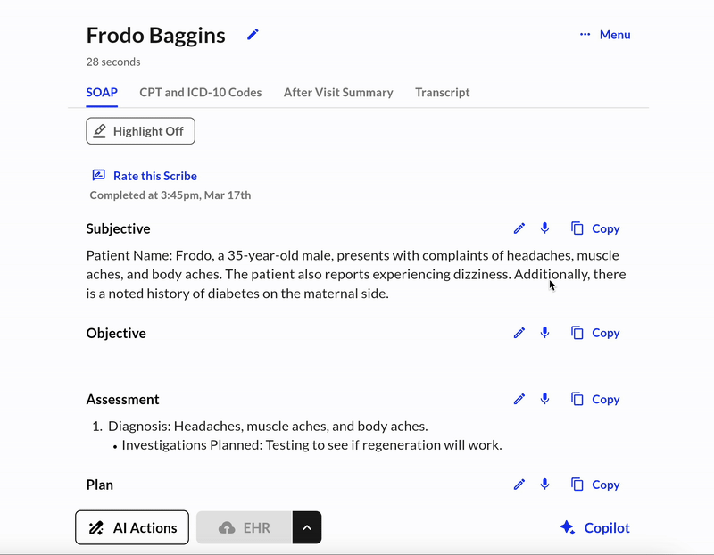

## Dictation

**Dictation** helps you edit notes with your voice and add context that you didn't get to during the visit.

<Frame>
  
</Frame>

### What It Does

- Uses real-time, speech-to-text technology to transcribe your voice into specific sections of your note.
- Meant to let you **quickly add context** without having to type out your edits.

---

### When and Where It Appears

- Displayed as a **microphone** icon next to each section of your note after it is generated
- You will need a stable Internet connection in order for the dictation engine to execute. You will see a clear notification if you are offline and try to dictate.

### Benefits

- Hands-free: we know it can be frustrating to click into a box and type out by hand
- Reduce time spent editing
- Utilize dictation to help restructure and regenerate your notes
