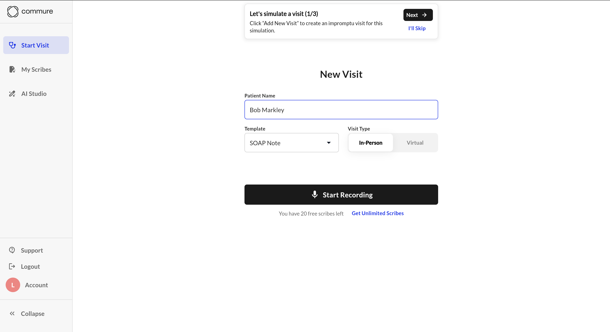

### How to record a Scribe:

1. Go to the 'My Visits' tab.
2. Input the Patient Name.
3. Select your Note Template.
4. Select whether your visit is "In-Person" or "Virtual".
5. Press "Start Recording" to begin scribing.
6. When finished, select "End Scribe" to generate the scribe.

To see a more detailed tutorial, check-out this [page](/basics/myscribes). 
